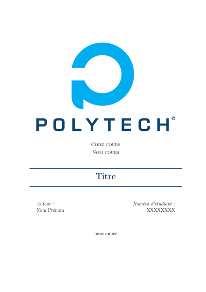
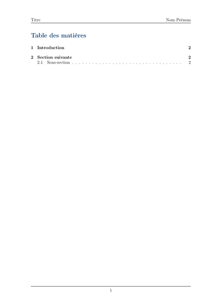

<!-- clean-readme: type=outil; langue=fr; v=2 -->
# Template LaTeX - rapports et devoirs

Ce dépôt contient un modèle LaTeX pour rédiger des devoirs et des rapports. Il fournit une page de garde, une table des matières, une mise en page uniforme et une bibliographie. Le document se compile avec pdfLaTeX et BibTeX.

> **État** : Terminé.

## Sommaire

- [Installation](#installation)
- [Usage minimal](#usage-minimal)
- [Fonctionnalités](#fonctionnalités)
- [Configuration et options](#configuration-et-options)
- [Structure du dépôt](#structure-du-dépôt)
- [Limites](#limites)

## Installation

### Prérequis

- Une distribution LaTeX qui fournit `pdflatex` et `bibtex` (TeX Live, MiKTeX).
- Les paquets utilisés : `natbib`, `babel` (français), `geometry`, `parskip`, `fancyhdr`, `graphicx`, `amsmath`, `url`, `xcolor`, `hyperref`, `titlesec`, `float`, `booktabs`.
- Testé sur : TeX Live 2026.

```bash
git clone https://github.com/antonin-biernacki/template_latex.git
cd template_latex
```

## Usage minimal

La bibliographie demande deux passes de `pdflatex` après `bibtex` :

```bash
pdflatex devoir_test.tex
bibtex devoir_test
pdflatex devoir_test.tex
pdflatex devoir_test.tex
```

Le fichier `devoir_test.pdf` commence par la page de garde puis la table des matières.





## Fonctionnalités

- Page de garde avec logo, code et nom du cours, titre, auteurs, numéros d'étudiant et date.
- Table des matières mise à jour à chaque compilation.
- Format A4, marges fixes, en-tête avec le titre et l'auteur, pied de page avec le numéro de page.
- Titres de section et de sous-section dans une couleur d'accent.
- Bibliographie avec `natbib` et le style `plain`, alimentée par `biblist.bib`.
- Tableaux avec `booktabs` et cellules colorées avec `xcolor`.

## Configuration et options

Les variables du document sont en haut de `devoir_test.tex` :

| Commande | Effet | Valeur par défaut |
|---|---|---|
| `\monTitre` | Titre sur la page de garde et dans l'en-tête | `Titre` |
| `\premierAuteur` | Auteur sur la page de garde et dans l'en-tête | `Nom Prénom` |
| `\secondAuteur` | Second auteur, commenté par défaut | `Nom Prénom` |
| `\maDate` | Date sur la page de garde | `mois année` |

Autres réglages dans `devoir_test.tex` :

- Couleur d'accent : `\definecolor{accentcolor}{RGB}{0, 51, 102}`.
- Logo : `logo-polytech.png` par défaut. La ligne de `universite-laval.png` est commentée juste en dessous.
- Second auteur : décommenter `\newcommand{\secondAuteur}`, la ligne `\rhead` qui cite les deux auteurs, `\secondAuteur` dans la page de garde et le second numéro d'étudiant.
- Sources : ajouter une entrée dans `biblist.bib`, puis la citer avec `\cite{clé}`.

## Structure du dépôt

```text
devoir_test.tex      # modèle de document
biblist.bib          # entrées de bibliographie
images/              # logos de la page de garde (dossier lu par \graphicspath)
apercus/             # captures utilisées par ce README
.gitignore           # ignore tout sauf les fichiers listés
```

## Limites

- Le code du cours, le nom du cours et le numéro d'étudiant sont écrits en dur dans la page de garde. Ils ne passent pas par des variables.
- Le document est configuré pour le français uniquement (`babel`).
- Le `.gitignore` ignore tout par défaut. Un nouveau fichier `.tex` ou une image hors de `images/` ne sera pas suivi par git sans ajout d'une exception.
